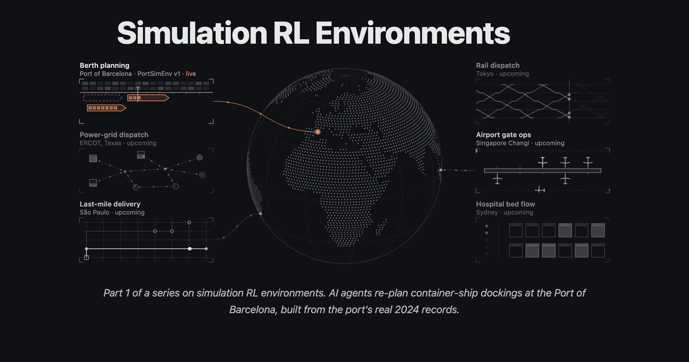
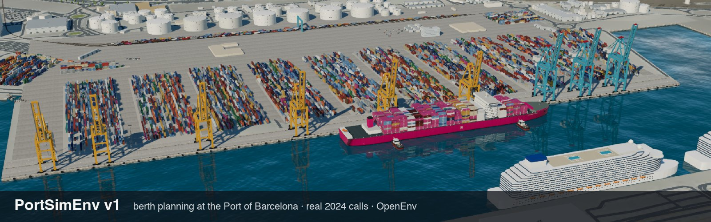

<h1>Simulation environments</h1>

<h3>Real work, rebuilt from its own records, as RL environments</h3>

A catalog of simulation environments and their evals, from FineEnvs and the community. Every environment grades the
agent deterministically, against a solver's reference rather than an LLM judge.

---

Most RL environments for language models are puzzles, code, maths or web tasks. A lot of valuable work looks
different: someone keeps a schedule running under real rules while things keep going wrong. Each environment here
takes one such job, rebuilds it from the records it leaves behind, and grades the agent's plan once against a solver's
reference, usually a proven optimum. There's no LLM judge.

The code lives here or in the author's own repo. Either way, every entry credits its authors and ships an eval card
in the same format, so environments can be compared and shown side by side, as in
[the article](https://fineenvs-simulation-rl-environments.hf.space/#the-live-port-portsimenv-v2v5).

## The catalog

<table>
<tr>
<td width="33%" valign="top">

<h3><a href="portsim-v1/">PortSimEnv v1</a></h3>
by <a href="https://github.com/adithya-s-k">Adithya S Kolavi</a> (Hugging Face) · AgentEnv port by <a href="https://github.com/earakely-scale">Edgar Arakelyan</a> (Scale AI)

Re-plan a broken week of container-ship dockings at the Port of Barcelona, from the port's 2024 records. One
plan, graded once.

OpenEnv, AgentEnv · 50 eval weeks · 6 models 
<a href="https://huggingface.co/spaces/FineEnvs/PortSimEnv">Play</a> ·
<a href="https://huggingface.co/spaces/FineEnvs/PortSimEnv-Eval">3D eval</a> ·
<a href="https://huggingface.co/datasets/FineEnvs/PortSimEnv">Dataset</a>
</td>
<td width="33%" valign="top">

<h3><a href="portsim-live/">PortSimEnv v2–v5</a></h3>
by <a href="https://github.com/earakely-scale">Edgar Arakelyan</a> (Scale AI)

The same quay, played watch by watch: live news (v2), pilots and tugs (v3), real wind and forecasts (v4),
and shipping lines that answer back (v5).

AgentEnv · 4 × 15 eval weeks · 12 models 
<a href="https://huggingface.co/spaces/earakely-scale/PortSimEnv-AgentEnv">3D replays</a> ·
<a href="https://huggingface.co/datasets/earakely-scale/PortSimEnv-AgentEnv">Dataset</a> ·
<a href="portsim-live/results/board.md">Board</a>
</td>
<td width="33%" valign="top">

<h3><a href="https://github.com/bp-high/RLSimEnvs">RailSimEnv</a></h3>
by <a href="https://github.com/bp-high">Bhavish Pahwa</a> · in the author's repo

Dispatch trains on the single-track Groningen–Leeuwarden line through real 2025 breakdowns and signal
failures: hold, short-turn or cancel so opposing trains cross safely.

OpenEnv · 45 hard eval tasks · 4 models 
<a href="https://huggingface.co/spaces/bpHigh/RailSimEnv">Play</a> ·
<a href="https://github.com/bp-high/RLSimEnvs">Code</a>
</td>
</tr>
<tr>
<td width="33%" valign="top">

<h3><a href="airopsenv/">AirOpsEnv v1–v3</a></h3>
by <a href="https://github.com/earakely-scale">Edgar Arakelyan</a> (Scale AI)

Run JetBlue through a real storm day at JFK or Boston, from public flight and FAA records: one hub's desk cancels
and holds flights (v1), then the whole network's control center, where an ops controller and a crew scheduler talk
(v2), then with its passengers on board and a customer desk for them (v3).

AgentEnv · 5 of 20 + 24 eval days (v2 and v3) · 1 model 
<a href="https://huggingface.co/spaces/earakely-scale/AirOpsEnv-AgentEnv">3D replays</a> ·
<a href="https://huggingface.co/datasets/earakely-scale/AirOpsEnv-AgentEnv">Dataset</a> ·
<a href="airopsenv/results/board.md">Board</a>
</td>
<td width="33%" valign="top"></td>
<td width="33%" valign="top"></td>
</tr>
</table>

The 3D scenes are built from © OpenStreetMap contributors (<a href="https://www.openstreetmap.org/copyright">ODbL</a>).
Each environment's README lists its data sources and licences.

## The evals

Each row comes from an eval card. 1.0 is the reference; the naive policy is a simple rule (keep or patch the
published schedule) played on the same tasks.

| Environment | Eval tasks | 1.0 means | Naive policy | Models | Best mean reward | Eval card |
|---|---|---|---:|---:|---|---|
| PortSimEnv v1 | 50 weeks, 4 tiers | the CP-SAT optimum | 0.20 | 6 | GPT-6.1 Sol 0.888 | [eval-v1.json](portsim-v1/results/eval-v1.json) |
| PortSimEnv v2, live | 15 weeks | the hindsight optimum | 0.20 | 12 | GPT-6 Astra 0.984 | [eval-v2.json](portsim-live/results/eval-v2.json) |
| PortSimEnv v3, marine | 15 weeks | the hindsight optimum | 0.19 | 12 | GPT-6 Astra 0.956 | [eval-v3.json](portsim-live/results/eval-v3.json) |
| PortSimEnv v4, wind | 15 weeks | the cheaper of hindsight and a forecast-following re-planner | 0.18 | 12 | Claude Opus 5.5 0.906 | [eval-v4.json](portsim-live/results/eval-v4.json) |
| PortSimEnv v5, lines | 15 weeks | the cheaper of hindsight and a re-planner that asks the ships | 0.18 | 12 | Claude Opus 5.5 0.593 | [eval-v5.json](portsim-live/results/eval-v5.json) |
| RailSimEnv | 45 hard tasks | the CP-SAT optimum | | 4 | Qwen3.8-2.4T-A95B 0.556 | reported by the author |
| AirOpsEnv v1, one desk | 5 of 20 days, picked by hand | the hindsight optimum | 0.25 | 1 | GPT-6.1 Sol 0.419 | [eval-v1.json](airopsenv/results/eval-v1.json) |
| AirOpsEnv v2, two desks | 24 dates | the best plan of aircraft and crews found in hindsight, beside its proven bound | 0.31 | 1 | GPT-6.1 Sol, two desks 0.598 | [eval-v2.json](airopsenv/results/eval-v2.json) |
| AirOpsEnv v3, three desks | 24 dates | the best plan found in hindsight under a passenger cost, beside its bound | 0.39 | 1 | GPT-6.1 Sol, three desks 0.721 | [eval-v3.json](airopsenv/results/eval-v3.json) |

The versions are not comparable with each other: each plays its own weeks with its own harness. Each card says how
its tasks were picked and what its grade excuses.

## Add your environment

There are two ways in:

- **Code here.** Open a PR that adds a folder like [portsim-live](portsim-live/): `envs/<env>/core/` for the logic,
  plus one folder per framework. [CONTRIBUTING](../CONTRIBUTING.md) has the layout.
- **Link only.** Your code, data and Hub repos stay where they are; the folder points to them.

Either way, the folder holds three files:

1. **`project.yaml`.** Title, tagline, `authors` (name, GitHub handle, affiliation), your Hub repos and frameworks.
   Copy [portsim-live/project.yaml](portsim-live/project.yaml), then run `python3 tools/build_index.py`. The root
   README lists the environment with your name on it.
2. **`README.md`.** The job, the data and its licences, how it's graded, and links to your code, Space and data.
3. **`results/eval*.json`.** One eval card per environment or version. Use
   [eval-v4.json](portsim-live/results/eval-v4.json) as a worked example.

| Card field | What goes in it |
|---|---|
| `env`, `version`, `authors`, `framework` | who built what, on which framework |
| `tasks` | the split, how many tasks, the source data, and how the tasks were picked |
| `harness` | the tools and the turn limit |
| `grading` | what 1.0 means, the reward formula, anything the grade excuses, and whether a judge is used |
| `baselines` | simple policies played on the same tasks |
| `models` | per model: runs, mean reward, 95% interval, valid plans, cost per episode |
| `links` | every run, the replays, the code |

Your data and Hub artifacts stay in your namespace, and the
[Simulation RL Envs collection](https://huggingface.co/collections/FineEnvs/simulation-rl-envs-6ac4eca150bd4b91790e2540)
links to them. If you'd like to talk an idea through first, start a thread in
[discussion #36](https://github.com/adithya-s-k/FineEnvs/discussions/36).
