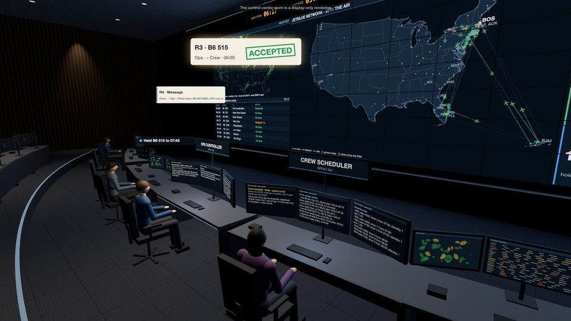

<div align="center">

<a href="https://huggingface.co/spaces/earakely-scale/AirOpsEnv-AgentEnv"></a>

<h1>AirOpsEnv v1–v3: the storm day, the ops control center and its passengers</h1>

<h3>Run JetBlue through a real storm day: one hub's desk, then the whole network from its control center, then with its passengers on board and a desk for them</h3>

<p>JetBlue's storm days at JFK and Boston rebuilt from public BTS, FAA and NWS records and played watch by watch on
AgentEnv's virtual clock, with the FAA's ground stops and ground delay programs arriving as they were issued, the
pilots and flight attendants under their federal duty rules, and, in v3, the passengers on board, rebooked by
JetBlue's own rules.</p>

<a href="https://huggingface.co/spaces/earakely-scale/AirOpsEnv-AgentEnv"></a>
<a href="https://huggingface.co/datasets/earakely-scale/AirOpsEnv-AgentEnv"></a>
<a href="https://github.com/scaleapi/agentenv-framework"></a>
<a href="https://github.com/earakely-scale/agentenv-airops-plugin"></a>

<sub>Three GPT-6.1 Sol desks run JetBlue's network through the storm of 8 July 2025 at JFK and Boston; every run
replays in the Space. The control-center room and its video wall are a display-only rendering by the plugin's viewer;
the wall's map is us-atlas (U.S. Census Bureau boundaries) and world-atlas (Natural Earth), its radar NEXRAD via the
Iowa Environmental Mesonet.</sub>

</div>

---

Three envs, each built on the last, play JetBlue's real storm days at JFK and Boston and grade the day once, with no
judge: v3, `airops-occ3`, puts the passengers on v2's day and adds a third desk for them; v2, `airops-occ`, runs the
whole network from two desks, the ops controller and the crew scheduler; v1, `airops-day`, is one hub's desk in its
storm hours, with aircraft only. This page leads with v3;
[v2 and v1](#v2-and-v1-the-ops-control-center-and-the-storm-day) follow.

## v3: passengers and the customer desk

v3 puts JetBlue's passengers on v2's storm days and adds the third desk real control centers have: the ops controller
and the crew scheduler are v2's, and the new **customer desk** looks after the passengers. Every flight carries its
booked passengers, about 86,000 trips on an eval date, some connecting at JFK, Boston, Fort Lauderdale, Orlando or San
Juan, generated from public records: each flight's load from BTS T-100, and who connects where from the DOT's ticket
survey of the date's own period. When a flight is cancelled or a connection missed, the passenger system rebooks its
passengers the way JetBlue's contract says: on JetBlue only, the earliest arrival first, for up to five days, then a
refund. The customer desk sees whose connections are at risk and where a cancellation's passengers would go, and asks
ops to hold a flight for them, not to cancel one, or to cancel one whose passengers are better off rebooked now; ops
decides. The days are v2's 24 eval storm dates, each graded once, on what really happened, under a cost that follows
every passenger to their final destination: against the best plan found in hindsight under that cost.

<p align="center">
  <a href="https://huggingface.co/spaces/earakely-scale/AirOpsEnv-AgentEnv?episode=https://huggingface.co/datasets/earakely-scale/AirOpsEnv-AgentEnv/resolve/v0.4.2/viewer/episodes/occ3-board-sol-joint.openai-gpt-6.1-sol.b6-20250708-0400.json&t=498&view=room&play=1&speed=2"></a>
</p>
<p align="center"><sub>Three GPT-6.1 Sol desks run JetBlue's network through the storm of Tuesday 8 July 2025 at JFK
and Boston (<code>b6-20250708-0400</code>): 637 flights from 04:00 with 81,279 passenger trips, and the FAA's ground
stops and ground delay programs at both hubs from the afternoon into the night. The crew scheduler makes 24 crew moves;
the ops controller holds 31 departures and cancels one flight; the customer desk sends ops 60 requests, and ops accepts
30 of its 46 HOLDs and 7 of its 8 PROTECTs and declines its 3 SUGGEST_CANCELs. Flown on what really happened, the day
costs 7.8% more than the best plan found and saves 85% of what standard crew-desk practice leaves on the table: reward
0.795, against 0.655 for one Sol agent at all three desks and 0.308 for the standard crew desk. In the clip the stranded
leave Kennedy on the hotel shuttle and passengers wait at the service counter after B6 675 to Hartford is cancelled;
in the room ops declines the customer desk's request not to cancel it (51 passengers booked); and connecting passengers
reach the gate of B6 308 to Portland, which ops held at the customer desk's request. Click it to replay the day in 3D,
from the control-center room at 08:18; the full film and two more, Boston on 10 December 2023 with three desks and
with one agent, are on the plugin's
<a href="https://github.com/earakely-scale/agentenv-airops-plugin/releases/tag/v0.4.1">v0.4.1 release</a>. Airport ©
OpenStreetMap contributors (ODbL), imagery USGS The National Map; flights BTS; advisories FAA ATCSCC; radar NEXRAD via
the Iowa Environmental Mesonet; passengers generated from BTS T-100 and the DOT's Origin and Destination Survey. The
control-center room, the gate halls, the crews' and passengers' paths, the lounges, the counter and the shuttle are
drawn for display only.</sub></p>

### The customer desk

|  | Ops controller | Crew scheduler | Customer desk |
|---|---|---|---|
| **Sees** | v2's picture, now with each flight's passengers (booked, connecting in and out) and the day's passenger costs | v2's picture | the connections at risk in the next 4 h; the flights ops might cancel in the next 6 h, with where their passengers would go if cancelled now (the same day, a later day, a refund) and how many have no later seat today; any flight's passengers by destination |
| **Does** | as in v2, and answers the customer desk's requests | as in v2 | looks passengers up |
| **Asks ops** | | HOLD, CANCEL, CANCEL_PAIR, TEXT | HOLD (a departure, for its connecting passengers), PROTECT (don't cancel a flight), SUGGEST_CANCEL (cancel one), TEXT |
| **Can't** | move or assign crews; rebook passengers | cancel or hold flights; rebook passengers | cancel, hold or crew flights; rebook passengers |

- **The customer desk proposes; ops decides,** as in real control centers, where the passenger desk can say
  "shouldn't" and crew and aircraft can say "can't". An accepted HOLD is ops' hold, as the crew desk's is; PROTECT and
  SUGGEST_CANCEL are advice, which ops carries out, if at all, with its own tools. Ops sends the crew desk COVER and
  TEXT, and the customer desk TEXT.
- **No desk rebooks.** The passenger system rebooks automatically, on JetBlue only, the earliest arrival first; holds,
  cancellations and their timing decide where the passengers go.
- **Turns.** Each hourly watch the crew desk takes its turn, then the customer desk, then ops; then the crew desk again
  if ops sent it a request or a text, and the customer desk if ops texted it. The env runs the turns, so every run
  replays exactly.
- **One agent** (mode `one`) runs all three desks from one page, with 16 of their tools and no channel, for comparison.

| desk | tools |
|---|---|
| ops | v2's seven: `ops_flights`, `ops_program`, `ops_aircraft`, `ops_check`, `ops_confirm`, `ops_request` (to the crew desk COVER or TEXT, to the customer desk TEXT), `ops_reply` |
| crew | v2's nine: `crew_flights`, `crew_crews`, `crew_reserves`, `crew_program`, `crew_options`, `crew_check`, `crew_confirm`, `crew_request`, `crew_reply` |
| customer | `cust_flights`, `cust_flight`, `cust_request` (HOLD, PROTECT, SUGGEST_CANCEL, TEXT) |
| all three | `end_turn`, `wait_turn`, `resign` |

Each desk is its own A2A agent, `airops-desk` in role `ops`, `crew`, `customer` or `both`, and sees only its role's
tools on the AgentEnv gateway. A day's task runs v2's steps on the env `airops-occ3`, with the customer desk deployed
and played beside the other two, and the audit checks every desk.

### Passengers and rebooking

The pack `b6-v3` is v2's 70 dates (24 eval storm dates, 44 training dates and 2 calm controls), each with its
passengers and its references under the passenger cost. No airline's itineraries are public, so the passengers are
generated stand-ins, labelled as such like v2's crews:

- **Who flies.** Each flight's booked passengers are its seats times the route's T-100 load factor that month, as in
  v2.
- **Who connects.** At JetBlue's connecting stations (JFK, BOS, FLL, MCO, SJU), a route's share of connecting passengers
  from each origin comes from the DOT's Origin and Destination Survey of the date's own period (the DB1B quarter up to
  June 2025, then the DB1C month), spread over the day's scheduled JetBlue-to-JetBlue connections by DB1C's connection
  times, with minimum connection times of 45 minutes at JFK and Boston and 40 elsewhere. An eval date has about 86,000
  passenger trips (59,412 to 96,759), 2.0% to 3.5% of them connecting.
- **How they are rebooked,** by JetBlue's own published rules: on JetBlue only, from the decision, the earliest arrival
  first (Contract of Carriage §37(c)); for up to five days, then a refund (its Customer Service Plan); a flight 3 h or
  more earlier only when no other seat is left (DOT's refund rule, 14 CFR 260.2). Crews keep their seats first. On a
  storm day JetBlue owes no compensation, meals or hotels, so none is charged; a night away costs the passenger a
  lodging night.

[DESIGN.md](DESIGN.md#v3-passengers-and-the-customer-desk) has the generator and the rules in full, with their sources.

### Grading under P

The day's cost P, in passenger-minutes: each passenger's arrival delay at their final destination, rebooking included
(a refunded passenger's wait); 66 for each cancelled flight's passenger, the refund exposure, more when the cancellation
comes under 2 hours ahead; a lodging night for each night a passenger waits; the fare of each passenger refunded; and
v2's aircraft and crew costs. v2 charged delay at every leg and a flat 523 per cancelled passenger.

| Reference | What it is | Mean reward, 24 eval dates |
|---|---|---:|
| best plan | the cheapest plan under P from a fixed set: v2's best plan, B0, the passenger-aware aircraft plans played through the standard crew desk, and a repair of the best of them; replayed exactly with a legal crew on every flight; not a proven optimum | 1.0 |
| bound | a capacity-aware lower bound on P, published per date: 54% to 79% under the best plan on the eval dates (median 66%), most of it the solver not finishing in its 30 minutes | |
| B0 | standard crew-desk practice with the aircraft doing nothing: 0.308 on 20 of the 24 eval dates, more on the 4 where it comes within 10% of the best plan | 0.386 |
| doing nothing | the planned crews by the trip rule, no desk at all | 0.329 |
| v2's best plan | v2's best plan of aircraft and crews, blind to passengers, played with them: at least 5% over the best plan on 17 of the 24 eval dates | 0.602 |
| the airline | JetBlue's own decisions, replayed with the generated crews and passengers | 0.239 |

The reward is v2's, under P: `0.2 + 0.8·e^(−g/0.5)`, with `g = max(0, P − best) / max(B0 − best, 0.1·best)`, and
`reward_L` is the same against the bound. A run is scored only if its audit passes, as in v2, every desk present to the
end or stood down, and the audit plays the passengers' day again to check what it cost. A day that comes in under the
best plan, which is not a proven optimum, scores 1.0 and is flagged `below_best`, with `reward_L` beside it. No judge.

### The v3 board

Six models ran the control center with three desks on the 24 eval dates, once a date each, at reasoning effort `high`:
GPT-6.1 Sol on 21 October 2026, which also played every date with one agent at all three desks, and on 22 October GPT-6
Astra, Claude Opus 5.5, Claude Sonnet 5.5, GPT-5.6 Terra and Kimi K3. Each board was registered before its first run,
as the plugin's README records: the dates, the caps and, for the five, the retries and how the models are compared.
Sol's cap was $3 a desk ($6 for one agent); each other model's buys what $3 bought a Sol desk, at its own prices.

| | Model | Mean reward (95% CI) | reward_L (95% CI) | Under the best plan | Valid days | Cost per episode | Cap a desk |
|---:|---|---|---|---:|---:|---:|---:|
| 1 | GPT-6 Astra, three desks | 0.742 (0.673 to 0.813) | 0.377 (0.356 to 0.406) | 6 | 24 of 24 | $22.68 | $23.50 |
| 2 | GPT-6.1 Sol, three desks | 0.721 (0.633 to 0.811) | 0.372 (0.351 to 0.398) | 7 | 24 of 24 | $2.97 | $3 |
| 3 | Claude Opus 5.5, three desks | 0.626 (0.544 to 0.711) | 0.357 (0.340 to 0.376) | 3 | 24 of 24 | $10.89 | $9.50 |
| 4 | Claude Sonnet 5.5, three desks | 0.556 (0.476 to 0.644) | 0.347 (0.330 to 0.367) | 2 | 24 of 24 | $3.01 | $5 |
| 5 | GPT-5.6 Terra, three desks | 0.515 (0.443 to 0.594) | 0.337 (0.324 to 0.353) | 1 | 24 of 24 | $3.52 | $5 |
| 6 | Kimi K3, three desks | 0.426 (0.366 to 0.491) | 0.326 (0.310 to 0.342) | 0 | 24 of 24 | $6.27 | $7.50 |
| | GPT-6.1 Sol, one agent at all three desks | 0.677 (0.592 to 0.766) | 0.366 (0.346 to 0.391) | 5 | 24 of 24 | $1.49 | $6 |
| | Standard crew desk (B0) | 0.386 | | | | | |
| | v2's best plan, blind to passengers | 0.602 | | | | | |

- **GPT-6 Astra has the highest mean, but the board doesn't separate it from GPT-6.1 Sol or Claude Opus 5.5:** their
  95% intervals overlap Astra's, and Astra leads Sol by 0.021. Claude Sonnet 5.5, GPT-5.6 Terra and Kimi K3 score below
  Astra, their intervals wholly under its own, and `reward_L` ranks the six in the same order. Each model played each
  date once, so a model's interval is over the dates, and nothing is paired across models.
- **Spend doesn't follow the ranking:** Astra's board cost 7.6 times Sol's for 0.021 more, and Kimi K3's 2.1 times
  Sol's for the lowest mean.
- **Flagged:** 24 of the 168 runs came in under the best plan found, all on 7 dates: Sol's 12 (7 three-desk and 5
  one-agent runs), Astra's 6, Opus's 3, Sonnet's 2, Terra's 1 and Kimi K3's none. They score 1.0, flagged
  `below_best`, which compresses the top of the board, and their `reward_L` is the fairer reading. On 4 of the 5 dates
  where both Sol modes did, B0 itself comes within 10% of the best plan, which is weak there.
- **Every run scored.** GPT-5.6 Terra's 24 took 31 attempts: 7 first attempts lost a desk to the provider's rate limit
  and scored on their retry, as registered. The caps stopped 5 of the five boards' 360 desks, all crew desks, and each
  of those runs scored.
- **Sol's three desks against its one agent, paired by date:** +0.044 reward (95% CI 0.007 to 0.083), three desks
  higher on 14 of 24 dates, lower on 5 and level on the 5 where both came in under the best plan.
- **It doesn't show that the third desk or talking helps.** A sign test on the 19 dates where the two differ gives
  p = 0.064. The three desks used about twice the compute (2.0× the spend), and there is no two-desk arm under P, so
  the board measures neither talking nor what the customer desk adds by itself.
- **Sol's customer desk was busy:** 1,303 requests over the 24 three-desk days, 887 HOLDs (463 accepted by ops), 184
  PROTECTs (177 accepted), 76 SUGGEST_CANCELs (24 accepted) and 156 texts.
- **Both Sol modes well above standard practice:** at the median a Sol day saves 71% (three desks) or 72% (one agent)
  of what B0 leaves on the table, and both modes' means are above v2's best plan played with its passengers.

[results/board.md](results/board.md#v3-passengers-and-the-customer-desk) has every date, the caps, the retries, the
requests, the spend and how the runs were made; the eval card is [results/eval-v3.json](results/eval-v3.json). These
scores are not comparable with v2's: the cost and the best plan differ.

### Run v3 here

With [uv](https://docs.astral.sh/uv/), Python 3.12 and Docker, as for v1 and v2 ([below](#run-it-locally)): fetch the
packs, which now include b6-v3's 70 dates, then play a day through AgentEnv on local Docker.

```bash
cd envs/airops
uv run -p 3.12 --with pyarrow python tools/fetch_packs.py           # b6-v1, b6-v2 and b6-v3 from the dataset at v0.5.0
cd agentenv
uv run -p 3.12 python rollout.py --env occ3 --smoke                 # no model: the crew and passenger systems alone
uv run -p 3.12 --extra dev python rollout.py --env occ3 --script    # no model: the scripted desks, both modes
uv run -p 3.12 python rollout.py --env occ3 --model openai/gpt-6.1-sol --mode joint --episode-cap-usd 3
uv run -p 3.12 python rollout.py --env occ3 --model openai/gpt-6.1-sol --mode one --episode-cap-usd 6
```

The board ran Sol at $3 a desk for three desks and $6 for one agent, and the other five models with three desks at
their own caps a desk (`--episode-cap-usd`): 23.5 for `openai/gpt-6-astra`, 9.5 for `anthropic/claude-opus-5-5`, 7.5
for `fireworks_ai/kimi-k3`, and 5 for `anthropic/claude-sonnet-5-5` and `openai/gpt-5.6-terra`. A median three-desk
Sol day took 70 minutes and $2.79, one agent 44 minutes and $1.52; [results/board.md](results/board.md) has every
model's. `tools/scripted_desks3.py` plays the scripted desks in process with the leak checks below, and
`tools/replay_runs.py` replays the dataset's recorded v3 runs through this code
([envs/airops/agentenv/README.md](envs/airops/agentenv/README.md) has the commands).

### How v3 was checked

v3 was built in stages, as v2 was: each check registered before it ran (FIDELITY.md discloses one eval date, 2024-07-13,
run once against a discarded model before step 0 was registered), every change to a rule recorded with its reason before
it was used, and the call to ship or stop made once. The plugin's
[FIDELITY.md](https://github.com/earakely-scale/agentenv-airops-plugin/blob/v0.5.0/FIDELITY.md) has the full report.

- **The premise.** Priced by P, v2's best plan costs at least 5% more than v3's best plan on 17 of the 24 eval dates (12
  needed), and before crews were added, v2's aircraft plan cost at least 5% more than a passenger-aware one on 16 (14
  without the 6 dates whose plans weren't stored). That comes from pricing each cancelled passenger by their real
  rebooking, not from the connections: the same 16 dates passed at half and at twice the connecting shares.
- **The passengers.** The generated bookings match T-100 within 5% on all 70 dates (close to true by construction: each
  flight's load is drawn from T-100), on the day and on the following days, and the median connection time matches
  DB1C's within 20 minutes at each of the 5 stations with 1,000 or more survey transfers. The connecting shares run low,
  0.1 to 1.9 points under the survey's: about 20% of the connections it implies can't be placed within 6 hours and
  become local passengers. That check failed, and v3 ships with it stated.
- **The references.** Every best plan replays exactly with a legal crew on every flight; an independent re-simulation
  reproduced the P of the best plan, v2's best plan, B0 and doing nothing on the 26 eval and control dates; and every
  plan played on a date costs at least its bound.
- **The scripted customer desk failed its gate.** Built from published practice (hold an outbound up to 15 minutes
  when 10 or more connecting passengers would misconnect; ask ops not to cancel a flight when half its passengers have
  no later JetBlue seat that day), it saved at least 2% against two scripted desks on 2 of the 24 eval dates, against
  12 needed. Its requests not to cancel mostly protected flights that couldn't fly, which then cancelled at their
  deadline, late. The customer desk ships anyway, labelled.
- **No leaks, exact replays.** Before any model ran, scripted desks played `airops-occ3` on 4 training dates in both
  modes (the plugin's checks; this port reran them on 2025-01-11 and 2025-01-15 with `tools/scripted_desks3.py`), each
  desk calling every lookup it has: every day graded, audited and replaying byte for byte; the day played again with
  every reference moved gives every page, reply and record before the end byte for byte, and none of them shows a
  reference, the bound or a reward; and the day with every delay a desk couldn't yet know changed gives everything up to
  the first watch from 10:00 byte for byte. A Sol pilot on 2 training dates scored all 4 runs, then Sol's board all 48
  and the five other models' boards all 120, each replaying exactly through the env's calls in the plugin, with its
  audit passing. This port's code replays Sol's 48 the same way, and the other models' 120 on Linux.
- **The numbers here.** Every v3 board number on this page, in [results/board.md](results/board.md) and in
  [results/eval-v3.json](results/eval-v3.json) recomputes from the dataset's v3 tables and runs at v0.5.0: each run's
  reward and `reward_L` from its graded cost and the pack's best plan, bound and B0 (all 168 within 1e-6), the means and
  their bootstrap intervals, the runs under the best plan, the desks the caps stopped, the spend, the paired difference
  and its sign test, the baselines, and the customer desk's requests; the stage checks above are FIDELITY.md's.

### What v3 doesn't model

- **International connections:** the survey and the on-time data are domestic only, so none are generated, though
  JetBlue flew 26% of its departures and 28% of its passengers internationally in 2025.
- **Rebooking on other airlines** (JetBlue's contract promises JetBlue only), **compensation, meals and hotels on storm
  days** (force majeure; a night away is the passenger's own lodging night), **rebooking by hand at the desk**,
  **passengers who choose a refund** (only those with no JetBlue seat within five days are refunded), **itineraries of
  three or more legs**, **extra sections and larger aircraft**, and **lost revenue and goodwill**.
- **The rules' dates:** the five-day window and DOT's 3-hour line apply on every date, though the plan's five-day
  wording dates from 2025 and DOT's rule from 2024-10-28.
- **No public record checks the passengers' outcomes.** JetBlue's own decisions, replayed under JetBlue-only
  rebooking, strand a median 80% of the passengers off its cancelled flights overnight; that is reported, not
  validated. And P prices a calm-day cancellation cheaply: on the winter control date the best plan cancels 7 flights
  at 04:00.
- **The best plan is a best-found plan,** from fixed candidates and one repair capped at 30 minutes (it ran past the cap
  on 49 of the 70 dates, which can only have made the plan cheaper), so 24 of the 168 board runs came in under it;
  **the bound is weak**, so `reward_L` reads low; and **B0 is near the best plan** on 4 eval dates, where it scores
  above 0.308.
- The Space's gate halls, crowds, walks, service counter and hotel shuttle are drawn for display only, not public
  data; the gate area is a generic one, not JetBlue's real Terminal 5 or Terminal C.

## v2 and v1: the ops control center and the storm day

v2 and v1 ship unchanged, with their packs, `b6-v2` and `b6-v1`, and their boards; v3 builds on v2's world and
crews without changing them.

### The task

An airline's operations control center keeps the schedule flying when the weather doesn't: it cancels and holds
flights, and it finds crews for the flights that keep flying. v1 and v2 play one of JetBlue's real storm days at JFK
or Boston. The day starts with only what the airline knew then; the rest arrives in hourly watches: each flight's own
delay 2 hours before it leaves, and the FAA Command Center's ground stops and ground delay programs as they were
issued. Time passes only when the watch ends: when v1's planner advances, or v2's desks have ended their turns. After
the last watch the day is flown on what really happened and graded once, with no judge.

| env | the day | graded against |
|---|---|---|
| v1 `airops-day` | one hub's 3 to 6 storm hours, about 60 to 190 flights on 30 to 60 aircraft, in 10 to 22 watches, with the METARs, TAFs and forecast discussions as issued; aircraft only | the hindsight optimum a MIP proves |
| v2 `airops-occ` | JetBlue's whole network from 04:00, about 700 flights, 220 aircraft and 900 crews and reserves, run by two desks that talk: the ops controller and the crew scheduler | the best plan of aircraft and crews a solver found in hindsight, next to its proven bound |

**v1, one desk.** The planner cancels, restores and holds flights. Aircraft of one type at an airport are
interchangeable, so the env dispatches them, keeps each hour's slot cap at JFK, Boston, Newark and LaGuardia, and
ferries aircraft at night to where tomorrow needs them.

| tool | what it does |
|---|---|
| `get_situation()` | the time, the freeze line, the slot caps as known for the next 8 hours, the FAA programs in effect, the latest METAR and TAF, every flight and where the aircraft are |
| `check_plan(changes)` | runs changes over the plan on the day as known, without committing them |
| `confirm_changes(changes)` | commits them; with `check_plan`, 3 planning calls a watch |
| `advance()` | ends the watch: the clock moves an hour and flights leave as planned |

**v2, two desks.** The ops controller runs the flights and aircraft with the FAA: it cancels flights and round trips,
holds them, and claims and swaps arrival slots in the FAA's programs. The crew scheduler runs the pilots (FAR 117) and
flight attendants (14 CFR 121.467): it calls reserves, swaps crews between trips, deadheads them and rests them in
hotels. Neither can do the other's job, so they talk, through typed requests the other desk accepts or declines (HOLD a
flight until its crew is ready, CANCEL, CANCEL_PAIR, COVER a flight) and free text. Each watch the crew desk takes its
turn, then ops, then the crew desk again if ops asked it something. A crew system crews every flight the crew desk
leaves alone by standard practice and can't cancel. In mode `one`, one agent runs both desks from one page, with no
channel.

| desk | tools |
|---|---|
| ops | `ops_flights`, `ops_program`, `ops_aircraft`, `ops_check`, `ops_confirm`, `ops_request` (COVER, TEXT), `ops_reply` |
| crew | `crew_flights`, `crew_crews`, `crew_reserves`, `crew_program`, `crew_options`, `crew_check`, `crew_confirm`, `crew_request` (HOLD, CANCEL, CANCEL_PAIR, TEXT), `crew_reply` |
| both | `end_turn` (its result is the next page), `wait_turn`, `resign` |

Each desk is its own A2A agent, `airops-desk`, in role `ops`, `crew` or `both`, and sees only its role's tools on the
AgentEnv gateway; v1's planner is `airops-llm`. These envs run on AgentEnv only: they need its gateway's virtual clock,
which the env moves at each watch, its triggers, which deliver each watch's news through a tool hidden from the agents,
and, for v2, its per-role tool access. [DESIGN.md](DESIGN.md) explains the watches, what is known when, the sim, the
crews, the references and the grade.

### Grading

**v1.** The final plan is flown on the day as it happened. Its cost, in passenger-minutes, is every passenger's
arrival delay, plus 523 per passenger on a cancelled flight, plus the night's ferries. The reward is
`0.2 + 0.8·e^(−g/0.5)`, with `g = max(0, cost − hindsight) / (hindsight − floor + 0.02·hindsight)`: 1.0 at the
hindsight optimum (a time-line MIP on the truth, proven to 0.01%), and never below 0.2, since the env never strands a
flight. The floor is the same MIP without aircraft routing.

**v2.** The day's cost adds, to the passengers' delay and cancellations (more when a cancellation comes under 2 hours
ahead), the FAA's rates for aircraft time on the ground and in the air, the night's ferries, crew deadheads, hotels
away from base and crews left out of place for tomorrow. The reward is `0.2 + 0.8·e^(−g/0.5)`, with
`g = max(0, cost − best) / max(B0 − best, 0.1·best)`:

- **best** scores 1.0: the cheapest day of aircraft and crews together a solver found knowing the whole day, replayed
  exactly with a legal crew on every flight. The joint problem can't be proven optimal at this size;
- **bound** is a proven lower bound on any day's cost. The gap between them is published per date (eval dates 2.4% to
  13.9%, median 5.1%), and `reward_L`, the same reward against the bound, is published beside the reward;
- **B0** scores 0.308: standard crew-desk practice with the aircraft doing nothing (each flight's planned crew, else
  the cheapest of a reserve, a swap, a deadhead or the 2-hour pilot extension, cancelling only when no legal crew can
  arrive in time).

**What is excused.** Nothing. Every cost of the day is charged, including what news after a flight's last chance to
change brings to it; the anchor knows every delay and program in advance, so 1.0 is out of reach online. On v1 the
re-planning follower, the MIP re-solved at every watch on the day as known, is the online reference. A v2 day that
comes in under the best plan, which is not a proven optimum, scores 1.0 and is flagged.

**When a run is scored.** v1: only if the day finished and every watch's news arrived before the agent's next call.
v2: only if its audit passes: every watch's news on time, every call in its desk's turn, no decision reaching back
before its minute, each desk in its role, a legal crew on every flight flown, the cost not under the proven bound, and
both desks present to the end or stood down.

**How the days were picked.**

| env | eval days | kept when |
|---|---|---|
| v1 `airops-day` | 20 hub windows of pack `b6-v1`, 12 at JFK and 8 at Boston, drawn from a pool covering 13 months between December 2022 and July 2025; the 20 fall in 7 months, 2023-07-09 to 2025-07-14. The board below played 5 of them, a first look picked by hand (3 JFK and 2 Boston; 3 summer and 2 winter), not a random sample; the plugin didn't record how they were chosen | among the 60 (day, hub) pairs of most disruption, the window of 3 to 6 whole hours where doing nothing costs most over the hindsight optimum, among windows where every hub movement has a typed tail, weather and air traffic control (BTS causes B and C) caused at least 80% of the cancellations in scope and 30 to 80 aircraft are in play; then doing nothing costs at least 10% over the optimum, the follower lands within 15% of it and the optimum is proven within 60 s; at most one per date and hub |
| v2 `airops-occ` | 24 storm dates of pack `b6-v2`, 12 drawn per storm hub (8 summer, 4 winter), each from its own storm event, from a pool covering 19 months between December 2022 and July 2026; the 24 fall in 11 of them | a storm date is one where the FAA's programs at JFK or Boston controlled or held at least 5 JetBlue flights; a date stays only if the crew model passes a filter fixed before the run (JetBlue's real day, crewed by the generated trips, leaves at most 1% of its flights without a legal crew, and crews add at most 2% to its calm day), which kept 100 of 180 storm dates; the eval dates were then drawn with seed 0, and the 44 training dates are every kept date of an event with no eval date, so no storm is in both |

Each eval card in [results/](results/) (`eval-v1.json`, `eval-v2.json`) states the same, with the baselines and where
the runs are.

### Results

GPT-6.1 Sol played both envs, one run per day, through the agentenv-airops plugin, whose env servers, task steps,
verifiers and agents, now at [v0.5.0](https://github.com/earakely-scale/agentenv-airops-plugin/tree/v0.5.0), live here;
every call of every run replays through them exactly, to the same grade (on Linux the whole record matches too; see
[DESIGN.md](DESIGN.md#determinism-and-replay)):

| Env | Runs | Mean reward (95% CI) | Valid days | Baselines on the same days | Cost per episode |
|---|---:|---|---:|---|---:|
| v1, one desk | 5 of the 20 eval days, picked by hand | **0.419** (0.319 to 0.547) | 5 of 5 | follower 0.730, doing nothing 0.247, JetBlue's own decisions 0.206 (on all 20 days: 0.729, 0.297, 0.210) | $0.60 |
| v2, two desks talking | 24 eval dates | **0.598** (0.545 to 0.658) | 24 of 24 | B0 0.308, the crew system alone 0.305, scripted desks 0.308 | $2.01 |
| v2, one agent at both desks | 24 eval dates | **0.550** (0.497 to 0.609) | 24 of 24 | as above; one scripted desk 0.295 | $1.02 |

- **v1.** Sol beats doing nothing and JetBlue's own decisions on every day it played and stays well below the
  re-planning follower: its days cost 18.9% over the hindsight optimum on average. Five runs on five days picked by
  hand are a first look, not a board, and not an estimate over the 20: doing nothing scores 0.247 on them against
  0.297 over all 20, and the blind follower 0.594 against 0.626.
- **v2.** Fixed before the first run, as the plugin's FIDELITY.md records: the code, the pack's hash, the dates, their
  order, the caps and the budget. Two Sol desks beat one Sol agent at both desks by +0.049 reward, paired by date (95%
  CI 0.024 to 0.075), higher on 18 of 24 dates, and both recover most of what standard crew-desk practice loses: at the
  median, about 60%.
- **It doesn't show that talking helps.** The two desks used about twice the compute (2.0× the spend, 2.0× the input
  and 2.5× the output tokens), and before any model ran, scripted desks failed the gate for talking: the channel was
  worth at least 5 points of the avoidable cost on 3 of 24 dates, against 15 needed.
- **Flagged.** On 2023-07-13 the two desks came in 1.5% under the best plan (reward 1.0), whose bound is 13.8% lower;
  `reward_L`, 0.578, is the fairer reading there. On 2026-07-09 the first two-desk attempt lost the crew desk's
  connection mid-day; the registered retry (0.464) replaces it, and the dataset keeps both.

These scores are not comparable with each other or with PortSimEnv's: each env plays its own days with its own harness.
[results/board.md](results/board.md) has every date, `reward_L`, the spend and how the runs were made.

### Known limits

[FIDELITY.md](https://github.com/earakely-scale/agentenv-airops-plugin/blob/v0.3.3/FIDELITY.md) in the plugin says
what is real data, what is modelled and how each layer was checked against the record, with every miss. In short:

- **The crews are generated.** JetBlue's pairings, rosters and reserve lists are not public: a cost-optimizing builder
  makes trips from the published schedule, and reserves sit at the middle of a sourced industry band. Union contract
  rules and multi-day limits are not modelled (crews start the day rested).
- **The crew filter leans the eval dates toward moderate storms.** The kept dates have fewer JetBlue cancellations
  than the dropped ones (median 20.5 against 28) and less aircraft-only leverage (6.1% against 10.4%), and the five
  dates of most aircraft-only leverage in the world's first build were all dropped. The room the crew desk leaves is
  similar (32.2% against 33.5% of the best plan).
- **The best plan is not a proven optimum, and the bound is loose.** The bound closes on no eval date (gaps of 2.4% to
  13.9%, median 5.1%), and, as FIDELITY.md puts it, "most of the gap is the bound's weakness rather than a measured
  distance to the optimum". So `reward_L` understates, and 1.0 against the best plan is not 1.0 against the
  optimum.
- **Missed checks, shipped as reported:** the calm-day check passed on 85.6% of dates against a 90% bar; on one winter
  control doing nothing ran 8.9% over the optimum because of one flight's real 733-minute delay; the standard crew
  desk missed the controls' 3% margin (+4.0% and +17.4%).
- **The FAA's slots are modelled** in v2: shared out by schedule over every carrier's arrivals plus an unseen stream,
  whose one scale per hub was fitted on the training dates of the world's first, aircraft-only build. The eval dates
  were drawn again over the dates the crew filter kept, and 14 of the 24 had been among those fit dates: in
  FIDELITY.md's words, they "were [training dates of the first build], where the unseen-traffic scale was fitted; the
  FAA-delay check on this eval set is not fully out of sample". v1 uses hourly caps instead: JetBlue's
  ration-by-schedule share of what all carriers actually moved, which a different plan would not have changed.
- **Left out:** passengers' connections and rebooking (a cancelled passenger costs a flat 523 passenger-minutes; v3 adds
  them), maintenance, dispatch, gates, and other airlines as actors. Delays are exogenous: holding or cancelling a
  flight never changes another airline's.
- **v1 is aircraft only**, at one hub, with interchangeable aircraft of a type and no crews.

## Start here

| You want to… | Open |
|---|---|
| Play a v3 day on AgentEnv | [Run v3 here](#run-v3-here) |
| Play a v1 or v2 day on AgentEnv | [envs/airops/agentenv](envs/airops/agentenv/) |
| Read how the watches, the sim, the crews, the passengers, the references and the grade work | [DESIGN.md](DESIGN.md) |
| See every run's score | [results/board.md](results/board.md) |
| Watch any run in 3D | [earakely-scale/AirOpsEnv-AgentEnv](https://huggingface.co/spaces/earakely-scale/AirOpsEnv-AgentEnv) |
| Get the days and every recorded run | [datasets/earakely-scale/AirOpsEnv-AgentEnv](https://huggingface.co/datasets/earakely-scale/AirOpsEnv-AgentEnv) |
| Watch the films | the plugin's [v0.2.0](https://github.com/earakely-scale/agentenv-airops-plugin/releases/tag/v0.2.0) (v1), [v0.3.0](https://github.com/earakely-scale/agentenv-airops-plugin/releases/tag/v0.3.0) (v2) and [v0.4.1](https://github.com/earakely-scale/agentenv-airops-plugin/releases/tag/v0.4.1) (v3) releases |
| Run pilots, film runs or publish to the Hub | [agentenv-airops plugin](https://github.com/earakely-scale/agentenv-airops-plugin) |

## Run it locally

You need [uv](https://docs.astral.sh/uv/) and Python 3.12, as CI and the images use, and Docker for the runs through
AgentEnv: `rollout.py` stages a bundle, agent-env builds the env and agent images on first use, starts a registry on
`127.0.0.1:5000` and runs the day on local Docker. The days the envs play are fetched, not committed (about 21 MB):
one command rebuilds them byte for byte from the dataset's tables at v0.5.0, whose v1 and v2 tables are v0.3.3's and v3
tables v0.4.2's, and checks every file against the committed manifests, which pin them. v3's commands are
[above](#run-v3-here).

```bash
cd envs/airops
uv run -p 3.12 --with pyarrow python tools/fetch_packs.py           # the days of tasks/b6-v1/, b6-v2/ and b6-v3/
cd agentenv
uv run -p 3.12 --frozen --extra dev pytest ../core/tests -q         # the day, the world, the crews, the references
uv run -p 3.12 --frozen --extra dev pytest tests -q                 # the envs, the task steps, the recorded v1 run
uv run -p 3.12 --frozen --extra dev pytest tests -q -m slow         # the minute-long replays: three follower days,
                                                                     # the recorded v2 and v3 days
uv run -p 3.12 python rollout.py --smoke                            # no model: v1's wiring-noplay, the naive day
uv run -p 3.12 python rollout.py --env occ --script                 # no model: v2's scripted desks, both modes
uv run -p 3.12 python rollout.py --model anthropic/claude-haiku-5-5 # through LITELLM_* or .agentenv/config.toml
HF_TOKEN=hf_... uv run -p 3.12 python rollout.py --model zai-org/GLM-5.3-Flash:baseten   # v1 on the HF router
uv run -p 3.12 python rollout.py --env occ --model openai/gpt-6.1-sol --mode joint --episode-cap-usd 5
```

The tests run on committed fixtures (four v1 days, three v2 dates and two v3 dates, a recorded run of each and the task
files the published runs played), so they need neither the fetched packs, the network nor Docker. The board ran v2 at $5
a desk for two desks and $8 for one agent (`--episode-cap-usd`, 2 by default). `tools/replay_runs.py` replays every
published run through this code; `tools/build_pack.py`, `references.py`, `world_check.py`, `crew_check.py`,
`build_occ_pack.py` and `scripted_desks.py` rebuild the packs and their references from the public records
([envs/airops/agentenv/README.md](envs/airops/agentenv/README.md) has the commands and their costs).

## Layout

```
07-simulation-environments/airopsenv/
├── README.md, DESIGN.md      this page; how the watches, the sim, the crews, the passengers, the references and the
│                             grade work
├── assets/banner.jpg         the banner: the control-center room with three desks in the Space's replay of 8 July 2025
├── data/                     a SOURCE.md per public source: BTS, the DOT's Origin and Destination Survey, FAA
│                             advisories, the FAA registry, FAA airport data, the IEM, airportsdata, the crew rules and
│                             costs, JetBlue's Contract of Carriage and Customer Service Plan, and DOT's refund rule
├── envs/airops/
│   ├── core/                 airops_core: v1's day (core/, refs/, day.py, schedule.py), v2's world and v3's
│   │                         passengers (programs/), the ops control center's day with two desks or three (occ/),
│   │                         and the pack builder (build/)
│   ├── agentenv/             airops_agentenv: the three envs' servers, task steps, verifiers, the airops-llm and
│   │                         airops-desk agents, rollout.py, Dockerfiles
│   ├── tasks/                b6-v1/, b6-v2/ and b6-v3/: the packs' manifests (committed) and their days (fetched);
│   │                         b6-v2-split.json and b6-v3-split.json, the splits; pax/, the survey extracts v3's
│   │                         passengers come from
│   └── tools/                fetch_packs.py, replay_runs.py, scripted_desks3.py, and the pack and reference builders
└── results/                  board.md; eval-v1.json, eval-v2.json and eval-v3.json, each env's eval card
```

## Data and licence

The flights, tails and delays (BTS on-time data), passengers (T-100), the fare in v1's cancellation cost (DB1B),
aircraft (Form 41 Schedule B-43 and the FAA registry), the FAA Command Center's advisories and the FAA's airport data
are U.S. Government works in the public domain; so are the METARs, TAFs and forecast discussions, NWS products archived
by the Iowa Environmental Mesonet, which asks for attribution, given here. Airport names, coordinates and time zones
come from airportsdata (MIT licence). v2's crew rules (14 CFR parts 117 and 121) and costs (the FAA's economic values,
BLS wages and CPI-U, GSA and DoD per diem rates) are U.S. Government works; its crew bases, fleet configurations and
deadhead fare are facts cited from JetBlue's 10-K filings and press releases, ALPA and Airline Pilot Central, each with
its URL in [crew_params.json](envs/airops/core/airops_core/programs/crew_params.json). v3's passengers come from T-100
and the DOT's Airline Origin and Destination Survey (DB1B and DB1C), U.S. Government works, through the three extracts
in `envs/airops/tasks/pax/`; its rebooking rules are facts cited from JetBlue's Contract of Carriage and Customer
Service Plan, whose text isn't copied here beyond the short quotes that identify a rule, and from DOT's refund rule (14
CFR 260.2), a U.S. Government work; a passenger's night away is priced at the GSA and DoD lodging rates. Each source's
`data/*/SOURCE.md` says what it is, where it comes from, how it is pinned and its terms. The packs, the test fixtures
and the recorded runs and transcripts derived from them carry the same terms: public domain, with the IEM's attribution
and the airportsdata MIT notice. The recorded runs also hold the model's own words (requests, replies, notes), as the
dataset publishes them under its card's terms. The fixtures are four v1 days, three v2 dates and two v3 dates cut from
the packs, the plugin's fixture v1 days, and slices of the raw inputs: BTS on-time, T-100 and B-43 rows, ATCSCC advisory
pages, the FAA registry, IEM METARs, TAFs and forecast discussions (`core/tests/pack/fixtures/`), and NASR airport rows
and BTS taxi-out times (`core/tests/programs/fixtures/`). The Space's 3D airports are © OpenStreetMap contributors (ODbL
1.0) over USGS The National Map imagery (public domain); they are the plugin's and the dataset's and are not in this
repository. The plugin's dataset is published under the terms on its card and isn't part of this repository. Code is
Apache-2.0 like the rest of the repository. Neither JetBlue, the DOT, the FAA, the BTS, the NWS, the USGS, the IEM nor
any union is affiliated with this project or endorses it.

Contributed from the agentenv-airops plugin (https://github.com/earakely-scale/agentenv-airops-plugin) by Edgar
Arakelyan (Scale AI), built on AgentEnv (https://github.com/scaleapi/agentenv-framework).
