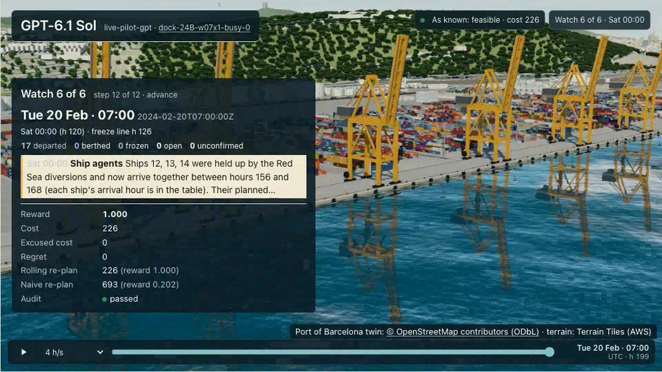

<div align="center">

<a href="https://huggingface.co/spaces/earakely-scale/PortSimEnv-AgentEnv"></a>

<h1>PortSimEnv v2–v5: live, marine, wind and lines</h1>

<h3>Run a quay at the Port of Barcelona through a week as it unfolds</h3>

<p>PortSimEnv's weeks played watch by watch on AgentEnv's virtual clock: the news arrives late, pilots and tugs run
short, the wind is the wind that blew, and the shipping lines answer back.</p>

<a href="https://huggingface.co/spaces/earakely-scale/PortSimEnv-AgentEnv"></a>
<a href="https://huggingface.co/datasets/earakely-scale/PortSimEnv-AgentEnv"></a>
<a href="https://github.com/scaleapi/agentenv-framework"></a>
<a href="https://github.com/earakely-scale/agentenv-portsim-plugin"></a>

<sub>GPT-6.1 Sol ends a live week at the hindsight optimum; every run replays in the Space. Twin © OpenStreetMap
contributors (<a href="https://www.openstreetmap.org/copyright">ODbL</a>) · terrain: Terrain Tiles on AWS.</sub>

</div>

---

## The task

[PortSimEnv v1](../portsim-v1/) hands the agent a broken week at one quay and grades one plan for all of it. Here the
same quay and the same 2024 weeks are played as they unfold. The week starts at Monday 00:00 with only what the port
knows then. The rest arrives in 6-hour bulletins, the watches: ships report delays and unscheduled calls, the harbour
master issues gale warnings and emergencies, terminal ops announce crane outages, the line desk flags priority cargo.
At each watch the agent confirms berth windows; a window about to start is frozen. When it calls `advance`, the clock
jumps to the next bulletin and the ships berth and sail on what it confirmed. The week is graded once,
deterministically, on the confirmed windows against the week as it really happened.

There are four envs, each adding to the one before:

| env | the week | graded against |
|---|---|---|
| v2 `portsim-live` | 15 one-week eval weeks of dock-v1, news watch by watch | the hindsight optimum CP-SAT proves |
| v3 `portsim-marine` | the same weeks, and every berthing and departure takes a pilot and tugs from pools shared with the port's other 2024 traffic | the marine hindsight optimum |
| v4 `portsim-wind` | 15 marine weeks moved into real Barcelona weather weeks of 2023-2025; an ECMWF forecast at every watch, graded on the wind that blew | the anchor: the lower of the hindsight optimum and a forecast-following re-planner's cost |
| v5 `portsim-lines` | the 15 wind weeks with each ship's agent, the firm that deals with the port for its line, deployed as its own A2A agent: ETAs that firm up, requested arrival times, late ships the port berths itself, a first-come queue and the cost of waiting at anchor | the anchor: the lower of the hindsight optimum, knowing every arrival, and a re-planner that asks the agents |

| tool | what it does |
|---|---|
| `get_situation()` | the watch, its time, the week as known now, the confirmed windows and the ships without one |
| `check_plan(plan)` | rule breaks and cost of windows merged over the confirmed ones; confirms nothing |
| `confirm_berths(plan)` | sets or changes windows; each refusal carries the harbour master's reason |
| `advance()` | ends the watch; after the last one the rest of the week runs and is graded |
| `message_agent(agent, requests)` | lines only: asks a ship's agent for its ships' ETAs or requests arrival hours |

`check_plan` and `confirm_berths` share 3 calls a watch. A valid week scores `0.2 + 0.8·e^(−gap/0.5)`, so the optimum
(on the wind and lines weeks, the anchor) scores 1.0; a week that breaks a rule scores below 0.2. [Grading](#grading) says what
is excused and how each env's weeks were picked.

These envs run on AgentEnv only: they need its gateway's virtual clock, which the env moves at each `advance`, and its
triggers, one per watch, which deliver the news through a tool hidden from the agent; the lines env also needs its
peered agents and per-role tool access. There is no OpenEnv port. [DESIGN.md](DESIGN.md) explains the watches, the
clock and triggers, the rules and the grade. The agentenv-portsim plugin and its Hub dataset number the envs the same
way: live v2, marine v3, wind v4, lines v5.

## Grading

A week is graded once, deterministically and with no judge: the windows the agent confirmed are run against the week
as it really happened, on the wind weeks in the wind that blew, and scored with berth_core's reward v3. A feasible week
scores `0.2 + 0.8·e^(−g/0.5)`, with `g = max(0, cost − reference) / (max(0, reference − floor) + 100)` and the floor
the cost no plan can avoid, so the reference scores 1.0. A week that breaks a rule scores 0.2 times its share of clean
ships, below 0.2, and a ship left without a window breaks a rule. The reference is the hindsight optimum CP-SAT proves
on the week as it happened (live and marine), or the anchor: on the wind weeks the lower of the hindsight optimum and
the best cost of the forecast-following re-planner over its 4 solver configurations, on the lines weeks the lower of
the hindsight optimum, which knows every arrival, and the best cost of the follower, which asks the ships' agents.

**What is excused.** A window's last chance to change is the last watch before it froze. Cost or a rule break that
news brings to a window after its last chance is not charged; a ship the agent moves into trouble after the news is.

- **v2 live and v3 marine** weigh each notice as it arrives: what it adds to the frozen windows, on their own, is
  excused.
- **v4 wind** judges each ship once, at its last chance, on the whole plan: cost or a rule break that later news
  brings, or wind the forecast didn't show at that ship's last chance, is waived for that ship. Wind the forecast
  showed then and that blew is charged, as an ignored warning, and a false alarm withdrawn after the freeze leaves no
  waiver.
- **v5 lines** excuses as v4 does, per ship, news and wind no forecast showed at that ship's last chance. An ETA that
  proves wrong is not news: the excuse weighs every window against the ships' real arrivals, so the lateness and the
  hours at anchor of a ship that arrives off what its agent said are charged. A ship whose arrival was agreed arrives
  at that hour.

**How the weeks were picked.**

| env | weeks | kept when |
|---|---|---|
| v2 `portsim-live` | 15 of the 18 one-week standard and busy eval weeks of dock-v1-eval | the rolling re-planner, re-planning on the week as known at every watch, reaches the hindsight optimum in at least 3 of its 4 solver configurations |
| v3 `portsim-marine` | the same 15, with the port's pilots and tugs | all 15 qualify as the live weeks do, on the marine hindsight optimum |
| v4 `portsim-wind` | 15 marine weeks moved into real Barcelona weather weeks, dealt from the 240 pairs of the 15 marine weeks and 16 weather weeks | (a) the forecast-following re-planner costs no more than the hindsight optimum in at least 3 of its 4 configurations, so the anchor is reachable on what the agent could know; (b) the re-planner blind to the wind, or on a bust week (forecasts of wind that didn't blow) the one that holds every forecast window, scores at most 0.9 in at least 3 of 4; (c) the week has at most 10 watches; (d) no ship alongside at hour 0 is due to leave inside a window above 30 kn |
| v5 `portsim-lines` | the 15 wind weeks, all of which qualify | (a) at least 3 of the follower's 4 configurations finish feasible; (b) the silent follower, which never asks the agents, scores at most 0.9 in at least 3 of 4, so asking matters; (c) the week has at most 10 watches |

[DESIGN.md](DESIGN.md) has the excuses, the anchors, the references and the deal in full. Each env's eval card in
[results/](results/) (`eval-v2.json` to `eval-v5.json`) states the same, with the baselines and where the runs are.

## The lines port

v5 plays the 15 wind weeks with the same freeze, wind, pilots and tugs; what changes is who the planner deals with.
Each ship has its agent, the firm the port's 2024 record names for the call, and each firm with a ship in the week is
deployed as its own A2A agent, `portsim-line`, peered with the planner, which gets a `message_agent` tool.

- **The schedule is an estimate.** It is the line's estimate from 72 hours out: each ship really arrives at its
  scheduled hour plus its agent's long-range error, mostly later.
- **ETAs firm up.** Each agent reports its ship's ETA 48 and 24 hours out and calls in an hour before it arrives. The
  ETAs are optimistic, by less as the ship nears, and the call is exact.
- **The planner can ask.** An agent commits to an hour once its ship has sailed from its previous port or its own
  estimate is within 48 hours. It then agrees an hour the ship can make at cruising speed (17 kn) or by slowing (to
  10 kn) once it has sailed, and the ship arrives at that hour; otherwise it offers the earliest or the latest it can
  make. Before that it gives its ETA.
- **News can undo an agreement.** Until the port's news about a delayed or bunched ship, its agent works from the
  plan as it stood; at the news an earlier agreement stands only if the ship can still make that hour.
- **The port berths late ships.** A ship that gets in after its window starts is berthed by the port at the first hour
  a free stretch of quay fits it, and nobody else moves; one that gets in early waits at anchor for its window.
- **First come, first served, for agreed ships.** No ship may start berthing while an earlier ship whose arrival was
  agreed waits at anchor, unless the wind holds that ship or the closures leave it no stretch of quay. A ship's turn is
  its arrival at cruising speed, so a ship slowed on request keeps it.
- **Waiting costs.** Each hour at anchor costs the ship's sections, as an hour late does.

The ships' agents have no model: each answers from the env, through two tools only their role sees (`ship_status`,
`agree_arrival`), so the same requests always get the same answers. `confirm_berths` on the lines env also returns
the confirmed plan's problems and cost, as `check_plan` does. A lines week gets 72 turns. Against each week's anchor,
the follower scores 0.548 in its first configuration, the silent follower 0.242 and the naive policy 0.184.
[DESIGN.md](DESIGN.md#lines-the-shipping-lines-answer-back) has the rules and their sources, the steps and the
references.

## Results

Twelve models on the 15 weeks of each env, one run each, 720 runs:

| Model | live | marine | wind | lines | All 60 weeks | Feasible weeks |
|---|---:|---:|---:|---:|---:|---:|
| Claude Opus 5.5 | 0.976 | 0.951 | 0.906 | 0.593 | **0.857** | 59 of 60 |
| GPT-6 Astra | 0.984 | 0.956 | 0.896 | 0.568 | **0.851** | 58 of 60 |
| GPT-6.1 Sol | 0.957 | 0.905 | 0.745 | 0.536 | **0.786** | 55 of 60 |
| Claude Sonnet 5.5 | 0.904 | 0.932 | 0.888 | 0.387 | **0.778** | 60 of 60 |
| Claude Haiku 5.5 | 0.694 | 0.639 | 0.583 | 0.258 | **0.543** | 57 of 60 |
| Qwen3.8-2.4T | 0.686 | 0.519 | 0.662 | 0.291 | **0.539** | 36 of 60 |
| DeepSeek V4.1 Flash | 0.754 | 0.598 | 0.480 | 0.168 | **0.500** | 34 of 60 |
| GLM-5.3 | 0.748 | 0.593 | 0.468 | 0.153 | **0.490** | 31 of 60 |
| GLM-5.3-Flash | 0.470 | 0.461 | 0.328 | 0.261 | **0.380** | 24 of 60 |
| Kimi K3 | 0.465 | 0.446 | 0.249 | 0.231 | **0.348** | 23 of 60 |
| GPT-6 Luna | 0.335 | 0.287 | 0.320 | 0.234 | **0.294** | 49 of 60 |
| Qwen3.8-27B | 0.055 | 0.073 | 0.090 | 0.143 | **0.090** | 1 of 60 |

On the live, marine and wind weeks the rolling re-planner (on the wind weeks, the forecast-following one) scores 1.000,
and the naive policy 0.202, 0.187 and 0.183; on the lines weeks the follower, which asks the ships' agents, scores
0.548, the silent follower 0.242 and the naive policy 0.184. Claude Opus 5.5 and GPT-6 Astra share the top. On the
lines weeks they and GPT-6.1 Sol lead within noise of each other, agreeing an arrival for 86% to 90% of a week's ships,
and Opus and Astra score above the follower; a model that rarely asks stays feasible but pays in hours at anchor. The
three best open models on the live, marine and wind weeks average within noise of Claude Haiku 5.5, but each breaks a
rule in 17 of those 45 weeks, and Haiku in one. Qwen3.8-27B finds a valid plan in 1 of 60 weeks, the clearest
headroom for training. These scores are not comparable with v1's eval: the agent re-plans as the week unfolds, with
47 turns a week (52 on the wind weeks, 72 with `message_agent` on the lines weeks), and plays 15 standard and busy
weeks per env rather than 50 across four tiers. [results/board.md](results/board.md) has each env's table with
intervals, and how the runs were made.

## Start here

| You want to… | Open |
|---|---|
| Play a week on AgentEnv | [envs/port_week/agentenv](envs/port_week/agentenv/) |
| Read how the watches, clock, triggers, rules and grade work | [DESIGN.md](DESIGN.md) |
| See every model's score | [results/board.md](results/board.md) |
| Watch any run in 3D | [earakely-scale/PortSimEnv-AgentEnv](https://huggingface.co/spaces/earakely-scale/PortSimEnv-AgentEnv) |
| Get the weeks and every recorded run, as the plugin publishes them | [datasets/earakely-scale/PortSimEnv-AgentEnv](https://huggingface.co/datasets/earakely-scale/PortSimEnv-AgentEnv) |
| Browse the Space, dataset and runs together | [the collection](https://huggingface.co/collections/earakely-scale/portsimenv-on-agentenv) |
| Plan the whole week in one go | [PortSimEnv v1](../portsim-v1/) |
| Run sweeps, film runs or publish to the Hub | [agentenv-portsim plugin](https://github.com/earakely-scale/agentenv-portsim-plugin) |

## Run it locally

Each env plays through `rollout.py`, which stages a task bundle and runs it with AgentEnv on local Docker:

```bash
cd envs/port_week/agentenv
uv run --frozen --extra dev pytest tests -q                    # the envs, the task steps and six recorded weeks
uv run python rollout.py --smoke                               # no model or key: a wiring week scores 0, audit ok
HF_TOKEN=hf_... uv run python rollout.py --env marine          # GLM-5.3-Flash on the Hugging Face router
uv run python rollout.py --model anthropic/claude-sonnet-5-5 --tasks 3   # through LITELLM_* or .agentenv/config.toml
```

The week model (`port_week_core`) has its own tests, run through the same project:

```bash
uv run --frozen --extra dev pytest ../core/tests -q             # real-wind cases skip until the wind build has run
```

**The wind and lines weeks are built on your machine.** They derive from the readings of Meteocat's station Y7,
which this repository doesn't redistribute, so it holds only the ECMWF forecast values, the weeks' identifiers and
sha256 pins. One command fetches the readings, builds the wind weeks and checks them against the pins; a second builds
the lines weeks from them:

```bash
cd envs/port_week
uv run -p 3.12 --with ortools==9.15.6755 --with-editable core python tools/build_wind.py
uv run -p 3.12 --with ortools==9.15.6755 --with-editable core python tools/build_lines.py
cd agentenv && uv run python rollout.py --env wind
uv run python rollout.py --env lines --model anthropic/claude-sonnet-5-5
```

The wind build took 24 minutes here: 15 to fetch the readings and 9 to solve on 14 processes; the lines build 27 more,
set by its slowest week. A rerun reuses its cache. Until they have run, `--env wind` and `--env lines` stop and
point to their build, and so does the server for `portsim-wind` and `portsim-lines`.

## Layout

```
07-simulation-environments/portsim-live/
├── README.md, DESIGN.md     this page; how the watches, clock, triggers, rules and grade work
├── assets/banner.jpg        the banner: the last watch of a live week in the Space's 3D replay
├── data/
│   ├── barcelona/           the port's 2024 calls of every ship type, for the marine pack (pinned, not committed)
│   ├── ecmwf/               ECMWF HRES 10 m wind at the port, 2023-2026 (points.jsonl.gz, CC BY 4.0)
│   └── meteocat/            pins of the Y7 readings and of the built wind and lines weeks; no readings
├── envs/port_week/
│   ├── core/                port_week_core: the week in watches, the live, marine, wind and lines worlds, packs,
│   │                        prompts
│   ├── agentenv/            port_week_agentenv: the four envs' server, task steps, verifier, rollout.py, Dockerfile
│   ├── tasks/dock-v1-marine/  the 18 marine weeks (tasks.jsonl, manifest.json)
│   ├── tasks/live/, marine/ the rolling and naive references (references.jsonl)
│   ├── tasks/dock-v1-wind/, wind/  the wind weeks and references, built by tools/build_wind.py (git-ignored)
│   ├── tasks/dock-v1-lines/, lines/  the lines weeks and references, built by tools/build_lines.py (git-ignored)
│   └── tools/               the data tools: build_wind.py, build_lines.py, wind_weather.py and the four
│                            *_references.py
└── results/                 board.md, twelve models on the live, marine, wind and lines weeks; eval-v2.json to
                             eval-v5.json, each env's eval card
```

The live weeks are portsim-v1's `dock-v1-eval` tasks, read through `berth_core`, and the agents are portsim-v1's:
`portsim-llm`, the planner ([agent](../portsim-v1/envs/berth_planning/agentenv/agent/)), and `portsim-line`, the
ships' agent of the lines weeks ([line_agent](../portsim-v1/envs/berth_planning/agentenv/line_agent/)).

## Data and licence

Port of Barcelona open data, CC BY-SA 4.0 ("Contains data from the Port de Barcelona open data portal"): the marine
pack and the live and marine references are derived databases under the same licence
([data/barcelona/SOURCE.md](data/barcelona/SOURCE.md)). The forecasts contain modified ECMWF open data, CC BY 4.0, with
ECMWF's full statement in [data/ecmwf/SOURCE.md](data/ecmwf/SOURCE.md). Nothing derived from Meteocat's readings is
committed: the wind weeks, and the lines weeks built from them, are built on your machine under the portal's terms,
which this repository doesn't relicense ([data/meteocat/SOURCE.md](data/meteocat/SOURCE.md)). Check those terms before
you share the built weeks, the results and transcripts of wind or lines runs (they repeat the observed windows), or an
image or dataset made with them. The lines weeks' ships' agents come from the port's 2024 calls too, and the previous
ports' distances from NGA Pub. 151, Distances Between Ports (no copyright claimed). The plugin's
Hub dataset is published by the plugin under the terms on its card and isn't part of this repository. Code is
Apache-2.0 like the rest of the repository.

Contributed from the agentenv-portsim plugin (https://github.com/earakely-scale/agentenv-portsim-plugin) by Edgar
Arakelyan (Scale AI), built on AgentEnv (https://github.com/scaleapi/agentenv-framework).
