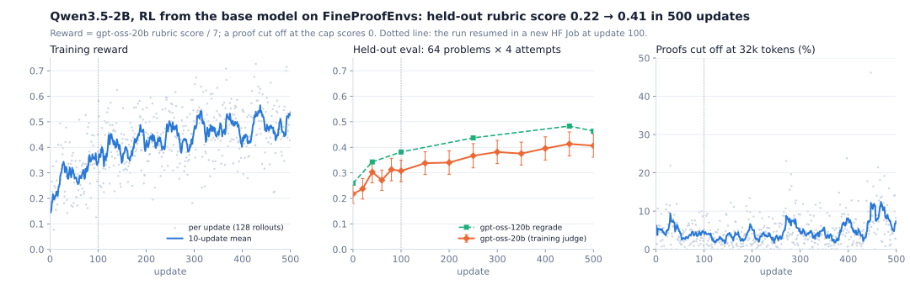

<h1>FineProofEnvs</h1>

<h3>Write an olympiad proof in plain language, graded 0–7 by a rubric judge</h3>

QED-Nano's training problems, rubrics and judge as Harbor tasks, and a model trained on them through our FineProof harness.

---

## The result

Qwen3.5-2B, trained with RL from the base model (no SFT) through the FineProof harness, raises its held-out rubric
score from **0.217 to 0.407** in 500 updates. gpt-oss-120b, regrading the same proofs, sees 0.259 → 0.464. Attempts
with full marks go from 12.1% to 25.4%. Training took 28 hours on an `h200x4` HF Job, resumed once from the bucket,
with the sandboxes, the judge and the logs also on Hugging Face.

The eval is 64 held-out problems × 4 attempts, and step 500 is the last checkpoint, not the best. Reading the proofs
shows new key ideas, not new phrasing. It also shows that both judges forgive contradictions around a correct
argument, so absolute scores run high. [training/RESULTS.md](training/RESULTS.md) has the full curve, the checks, and why
the first attempts collapsed.

On the Hub:
- **Tasks:** [`FineEnvs/fineproof-envs-train`](https://huggingface.co/datasets/FineEnvs/fineproof-envs-train) and
  [`-test`](https://huggingface.co/datasets/FineEnvs/fineproof-envs-test), runnable with `harbor run`.
- **Trained model:** [`FineEnvs/Qwen3.5-2B-FineProof-RL`](https://huggingface.co/FineEnvs/Qwen3.5-2B-FineProof-RL).
- **Every eval attempt, with its proof and grades:**
  [`FineEnvs/fineproof-rl-runs`](https://huggingface.co/datasets/FineEnvs/fineproof-rl-runs).

[DESIGN.md](DESIGN.md) has the reasoning behind the tasks and the verifier.

[QED-Nano](https://huggingface.co/lm-provers/QED-Nano) is a 4B model trained by CMU, Hugging Face, ETH Zurich and
Numina to write olympiad proofs. Its reward is an LLM judge: gpt-oss-20b scores each proof 0–7 against a
problem-specific rubric. The team released the problems, the rubrics, the judge's prompt and benchmarks for the
judge itself. This project packages them as [Harbor](https://github.com/harbor-framework/harbor) tasks any agent can
attempt: write a proof, and a separate sandbox grades it with the same judge, hardened against injected grades.

It is the other end of [openai-math](../openai-math/): there a proof must pass the Lean kernel and match the
statement exactly; here a natural-language proof earns partial credit for the steps it gets right.

<!-- BEGIN:matrix -->
| Env | Tools | Backend | `harbor` |
|---|---|---|---|
| **olympiad_proofs** | shell (Python) | `daytona` | ✅ |
<!-- END:matrix -->

## What's here

| Folder | What it is responsible for |
|---|---|
| [`envs/fineproof/harbor/`](envs/fineproof/harbor/) | The tasks and the verifier. The generator (`python -m fineproof_harbor.adapter`) writes Harbor tasks; `templates/tests/grade.py` is QED-Nano's judge plus safeguards against injected grades; unit tests |
| [`training/`](training/) | The **FineProof harness** (our Harbor agent: write a proof, grade it, rewrite it) and the AsyncGRPO recipe that trains through it with OpenEnv's Harbor integration: HF Jobs launchers, checkpoint evals, the regrade check. [README](training/README.md) to run it, [RESULTS](training/RESULTS.md) for what it did |
| [`results/`](results/) | Eval cards and run results as JSON: the OpenEnv parity checks, the step-0 benchmarks, and `fp-rl2-2b.json` (every eval, regrade and update) |
| [`assets/`](assets/) | The figure above and the script that draws it from `results/fp-rl2-2b.json` |
| [`DESIGN.md`](DESIGN.md) | Why the tasks, the judge and its safeguards are built this way, and the open licensing questions |

## Task sets

| Set | Tasks | From |
|---|---:|---|
| train | 5,099 | [lm-provers/FineProofs-RL](https://huggingface.co/datasets/lm-provers/FineProofs-RL), with QED-Nano's difficulty labels |
| test | 128 | `lm-provers/FineProofs-RL-test`; these 128 are also in FineProofs-RL, so train leaves them out |
| IMO-ProofBench | 60 | [lm-provers/IMOProofBench](https://huggingface.co/datasets/lm-provers/IMOProofBench) |
| ProofBench | 145 | [lm-provers/ProofBench](https://huggingface.co/datasets/lm-provers/ProofBench), splits `24_25` and `other` |

## Through OpenEnv

The tasks and the FineProof harness run through stock `openenv harbor serve`, the server training uses, with the harness named
by import path (`--harness fineproof_agent.agent:FineProofAgent`). That needs
[openenv/OpenEnv#1573](https://github.com/openenv/OpenEnv/pull/1573), which makes `module:Class` work and gives a
host-side agent the capture proxy's loopback URL. Before it, a public tunnel cut long proofs with a 502 and the
retries were recorded as extra conversations.

Eval mode, on the 64 validated test tasks: Qwen3.5-9B on deepinfra (thinking off), the FineProof harness, Daytona, judge
gpt-oss-20b. The two paths agree within noise ([results/openenv-parity-v1.json](results/openenv-parity-v1.json)):

| Path | Graded | Mean reward | Full marks |
|---|---:|---:|---:|
| `openenv harbor serve` + `training/evaluate.py --hosted` | 64/64 | 0.667 | 34 |
| `harbor run` | 64/64 | 0.717 | 40 |

Per task, OpenEnv minus Harbor averages −0.049 with a standard error of 0.046. Every rollout made exactly 2 model
calls on both paths.

Training tier, on the same 64 tasks: Qwen3.5-9B on our own vLLM (one B200, serving token ids and processed
logprobs) with the recipe's training sampling (temperature 0.8, top_p 1). 63 of 64 rollouts were graded; the judge's
provider rate-limited the last one. Mean reward 0.753, 42 full marks
([results/openenv-training-tier-v1.json](results/openenv-training-tier-v1.json)). Every graded rollout gave a valid
`TrainingTrace`, the object TRL's `HarnessRolloutWorker` trains on:
- both calls are trainable;
- there is one logprob per sampled token;
- the prompt is masked out;
- the engine's prompt tokens match a local re-render on all 126 turns.

## Credits

Problems, rubrics, benchmarks and the judge's prompt are from the
[QED-Nano](https://huggingface.co/spaces/lm-provers/qed-nano-blogpost) release by the LM-Provers team (CMU, Hugging
Face, ETH Zurich, Numina; [code](https://github.com/CMU-AIRe/QED-Nano), Apache-2.0). The problems come from
[AI-MO/olympiads](https://huggingface.co/datasets/AI-MO/olympiads) and [AI-MO/aops](https://huggingface.co/datasets/AI-MO/aops)
(Art of Problem Solving). DESIGN.md lists the open licensing questions.
