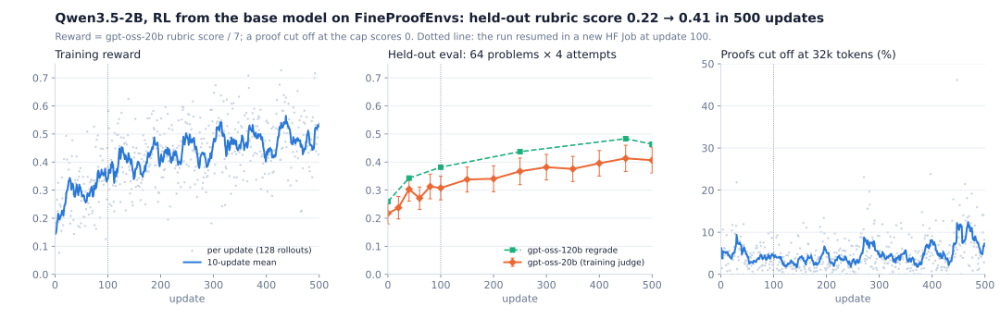

# Results: RL from the base model on FineProofEnvs

Qwen3.5-2B, non-thinking mode, trained with AsyncGRPO through the FineProof harness. No SFT. The reward is
gpt-oss-20b's rubric score / 7. Everything ran on Hugging Face: HF Jobs for the trainer, the policy engine and the
evals; HF Sandboxes for the task containers; Inference Providers for the judge; a bucket for checkpoints and logs.

- **Model:** [`FineEnvs/Qwen3.5-2B-FineProof-RL`](https://huggingface.co/FineEnvs/Qwen3.5-2B-FineProof-RL), the
  step-500 checkpoint in bf16.
- **Logs:** the [Trackio dashboard](https://huggingface.co/spaces/FineEnvs/fineproof-rl-trackio) has every update and
  every eval.
- **Eval attempts:** [`FineEnvs/fineproof-rl-runs`](https://huggingface.co/datasets/FineEnvs/fineproof-rl-runs) has
  every attempt's proof with the judge's assessment, as tables.
- **Numbers:** [`../results/fp-rl2-2b.json`](../results/fp-rl2-2b.json) and
  [`../results/fp-rl2-4b.json`](../results/fp-rl2-4b.json).
- **Figure:** [`../assets/plot_curves.py`](../assets/plot_curves.py) redraws it from the 2B numbers.

## The result

| Held-out eval, 64 problems × 4 attempts | step 0 | step 500 | change (paired by problem) |
|---|---:|---:|---:|
| **mean rubric score**, gpt-oss-20b (training judge) | 0.217 | 0.407 | +0.190 ± 0.030 |
| mean rubric score, gpt-oss-120b regrade, high effort | 0.259 | 0.464 | +0.204 ± 0.034 |
| attempts with full marks (7/7) | 12.1% | 25.4% | |
| problems with a full-marks attempt (pass@4) | 26.6% | 40.6% | |
| attempts with any credit | 41.0% | 64.1% | |

Step 500 is the last checkpoint, not the best one, so choosing it never looked at the eval.
47 problems improved and 6 got worse.

**The independent judge:** gpt-oss-120b, which QED-Nano reports its benchmarks with, regraded the same proofs at
six checkpoints. It measures the same gain as the training judge at step 40 (+0.083 against +0.086), and a larger one
from step 100 on. So the rise is not one judge's taste.

**The eval set:** the 64 problems of FineProofs-RL-test whose reference proof gpt-oss-120b scores at least 6/7, so
the rubric and the judge are known to reward a correct proof
([`benchmarks/test-validated-64.txt`](benchmarks/test-validated-64.txt)). None of the 128 test problems is in the
training pool. Attempts are sampled at temperature 0.8 with a 32,768-token cap, as in training.

## The run

| | |
|---|---|
| Model | `Qwen/Qwen3.5-2B` at a pinned revision, non-thinking mode |
| Harness | FineProof, one call (`--rounds 0`): write the proof, the verifier grades it |
| Training problems | 1,066 FineProofs-RL problems on which QED-Nano's base model averaged 0.5–0.9 (`--min-mean 0.5`): the easier end of the pool, for the smaller model |
| Update | 128 rollouts: 8 problems × 16 attempts |
| Objective | reward minus the group mean (no division by its std); token losses summed and divided by 32,768 per rollout |
| Cut-off proofs | reward 0 (the judge's grade of the text is still logged as `judge_reward`) |
| Optimizer | AdamW 8-bit, learning rate 1e-6, 10 warm-up updates, weights in fp32 |
| Sampling | temperature 0.8, proofs up to 32,768 tokens, vLLM context 131,072, CUDA graphs |
| Judge | gpt-oss-20b on Inference Providers (groq, then featherless-ai), 2 grades per proof, averaged |
| Hardware | one `h200x4` HF Job: vLLM data-parallel on 3 GPUs, the trainer on 1; task sandboxes as HF Sandboxes |
| Length | 500 updates in two Jobs: 0 → 100, then resumed from the bucket to 500 (28 h in all) |
| Cost | about $580 of GPU time ($20/h for `h200x4`) and $241 of judge calls for the 64,000 training rollouts; each eval is a separate, shorter Job |

## The eval curve

| step | 20b judge | vs step 0 | 120b regrade | full marks | pass@4 |
|---:|---:|---:|---:|---:|---:|
| 0 | 0.217 ± 0.037 |  | 0.259 | 12.1% | 26.6% |
| 20 | 0.237 ± 0.040 | +0.021 ± 0.022 |  | 15.2% | 26.6% |
| 40 | 0.303 ± 0.043 | +0.086 ± 0.023 | 0.343 | 19.5% | 34.4% |
| 60 | 0.271 ± 0.040 | +0.054 ± 0.022 |  | 16.0% | 26.6% |
| 80 | 0.313 ± 0.044 | +0.096 ± 0.025 |  | 19.9% | 32.8% |
| 100 | 0.308 ± 0.042 | +0.091 ± 0.022 | 0.382 | 17.2% | 29.7% |
| 150 | 0.338 ± 0.045 | +0.121 ± 0.025 |  | 20.7% | 34.4% |
| 200 | 0.340 ± 0.046 | +0.124 ± 0.026 |  | 22.7% | 31.2% |
| 250 | 0.367 ± 0.047 | +0.150 ± 0.027 | 0.437 | 24.2% | 34.4% |
| 300 | 0.382 ± 0.046 | +0.165 ± 0.027 |  | 24.6% | 37.5% |
| 350 | 0.376 ± 0.045 | +0.159 ± 0.030 |  | 22.3% | 35.9% |
| 400 | 0.396 ± 0.046 | +0.179 ± 0.031 |  | 25.0% | 39.1% |
| 450 | 0.413 ± 0.047 | +0.196 ± 0.033 | 0.483 | 26.6% | 35.9% |
| 500 | 0.407 ± 0.046 | +0.190 ± 0.030 | 0.464 | 25.4% | 40.6% |

Evals ran every 20 updates up to 100, then every 50. The mean rose fastest in the first 40 updates, then kept
climbing slowly; no checkpoint after 100 is below step 100.

## Is the model really better?

We read the step-250 eval's proofs next to step 0's on the same problems:

- **New key ideas, not new phrasing.** Four 7/7 proofs on problems that had scored 0–1.5 at step 0 were checked by
  hand. All four use the step the base model missed: a QM-AM bound, an even-polynomial substitution, a recurrence on
  products of consecutive terms, and a corrected off-by-one count.
- **No length hack.** Within a problem, longer proofs do not score higher, and looping outputs fell from 5% to 2%.
- **A format habit with no effect on the score.** By step 250, 98% of replies open with "Here is the complete
  proof" and wrap it in a Markdown block. Adding that wrapper to step-0 proofs, or removing it from step-250 proofs,
  moves the judge's score by at most 0.02.
- **Both judges are lenient on messy proofs.** Two of the four 7/7 proofs keep false statements and an unresolved
  contradiction around the right argument. A careful grader gives them about 4/7; gpt-oss-20b and gpt-oss-120b gave
  6–7. The base model already wrote its scratch work into the answer (94% of step-0 replies), so this inflates the
  absolute scores at every step, not the gain.

## The 4B run

Qwen3.5-4B with the same recipe on a harder pool (1,045 problems averaging 0.25–0.6, `--max-mean 0.6`), 100 updates: 0.684 at step 0,
0.671 at step 100 (−0.013 ± 0.029). Stable, but flat: the 4B starts with a much higher score, so these problems
leave it less to learn. A longer run or harder problems are the next things to try.

## What failed first

The first runs used TRL's AsyncGRPO defaults with 16k-token proofs and 40 rollouts per update. Both rose for about
40 updates and fell back: the 2B went 0.180 → 0.281 → 0.186 at steps 0, 40 and 80. The judge was not being gamed
(the 120b regrade tracked it, problem correlation 0.93). The proofs grew until most were cut off, because:

- **A cut-off proof still got partial credit,** so running out of tokens cost little. → It now scores 0.
- **Each rollout's loss was averaged over its own tokens,** since TRL trains one rollout per micro-step. A long wrong
  proof weighed as much as a short one. → Losses are summed and divided by the 32,768-token cap, as in QED-Nano's
  recipe and Dr. GRPO.
- **Advantages were divided by the group's std,** which amplifies a single noisy judge grade. → Mean-centred only,
  with 2 judge grades per proof.
- **Updates were small** (40 rollouts) and the resumed 2B lost its optimizer state. → 128 rollouts per update, and a
  resume restores the full checkpoint from the bucket.

The changes are in [`objective.py`](objective.py) and [`tasks.py`](tasks.py), and are covered by
[`tests/`](tests/).

## Limitations

- **One judge family.** The reward and the eval both come from gpt-oss. The 120b regrade is a second opinion, not an
  independent grader, and the hand audit shows both forgive contradictions around a correct argument.
- **One run per model,** no seeds, and 64 eval problems. The paired standard errors are about 0.02–0.03.
- **One rollout per row.** Packing is off because TRL marks packed samples only through position ids, which Qwen3.5's
  linear-attention layers ignore. This costs throughput, not correctness.

Next: make the judge grade only the final committed proof and deduct for false statements; train the 4B longer on
harder problems; evaluate on IMO-ProofBench.
