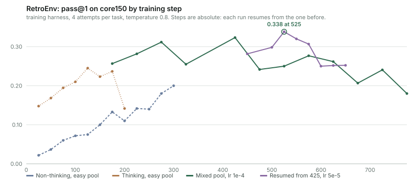

# Results

Four GRPO runs against RetroEnv, and the 13-model board they are measured against.



## What the training did

`core150`, the training harness, 4 attempts per task at temperature 0.8. The full per-checkpoint
table — all 42, with per-tier rates and how many episodes each evaluation graded — is
[`../train/checkpoints.json`](../train/checkpoints.json).

| | pass@1 | pass@4 | easy | medium | hard |
|---|---:|---:|---:|---:|---:|
| `Qwen/Qwen3.8-27B`, thinking off | 0.015 | 0.047 | — | — | — |
| best non-thinking, step 300 | 0.200 | 0.347 | 0.46 | 0.14 | 0.08 |
| `Qwen/Qwen3.8-27B`, thinking on | 0.118 | 0.233 | 0.235 | 0.085 | 0.035 |
| **best overall, step 525** | **0.338** | **0.547** | 0.62 | 0.34 | 0.18 |

Tier figures are first-attempt rates, which average to the first-attempt pass rate (0.380 for step
525), not to the pass@1 above — that is the unbiased estimate over all four attempts.

The four runs, in the order they were trained:

| Run | Steps | Pool | Thinking | Peak pass@1 |
|---|---|---|---|---:|
| `easy2k-shaped-r1` (+`-cont`, `-cont3`) | 0–300 | `train-easy2k` | no | 0.200 at 300 |
| `easy2k-shaped-think-r2` | 0–200 | `train-easy2k` | yes | 0.245 at 125 |
| `think-mixed-r3` | 125–775 | `train-mixed2k` | yes | 0.323 at 425 |
| `think-mixed-r4` | 425–650 | `train-mixed-fresh` | yes | **0.338 at 525** |

Every run's checkpoints, episodes, logs and evaluation boards are public in the
[`AdithyaSK/retroenv-rl-runs`](https://huggingface.co/buckets/AdithyaSK/retroenv-rl-runs) bucket
(174 GB). The scores here were recomputed from those evaluation shards on 2026-11-24 rather than
copied from the tables the watcher wrote while the runs were going.

## The honest version

**Thinking is most of the gain.** 200 steps of non-thinking RL reached 0.132, which is roughly what
turning thinking on gets you for free (0.118). The runs that matter all have thinking on.

**Both mixed-pool runs climb to a peak and then decline.** r3 peaked at 425 and fell to 0.180 by
775; r4 resumed from that peak at half the learning rate, on tasks the checkpoint had never seen,
peaked 0.015 higher and then followed the same shape down. Halving the learning rate changed the
height, not the shape. There is no reference-KL penalty in this setup — `AsyncGRPOConfig` has no
`beta`, so the logged `train/kl` is a diagnostic and nothing pulls the policy back toward the base
model. That is the most plausible single cause and the first thing to test.

**Two checkpoints have no comparable score.** `think-mixed-r3` step 375 lost nine of its ten
evaluation shards to the 4-hour job timeout, and `think-mixed-r4` step 475 lost seven of twenty to
an image-pull failure. Both are marked `"complete": false` in `checkpoints.json` and are left off
the curve.

**Twice during r3, completions blew out** to a 31k-token mean with a clip ratio of 0.469 and the
solve rate crashed; both times it recovered within three to five updates with no intervention.
Three explanations were tested and none held — hard tasks truncated at 2% against medium's 7%, so
difficulty is not it. Cause unknown.

## The board

[`core30-board.md`](core30-board.md) is the published 13-model board: 30 tasks drawn from
`final_eval`, the evaluation harness, 16 turns, 1 attempt, temperature 0, thinking off, no
submission repair. [`core30-board.json`](core30-board.json) has the per-model detail.

| Model | pass@1 | | Model | pass@1 |
|---|---:|---|---|---:|
| gpt-6-astra | 0.567 | | DeepSeek-V4-Pro | 0.133 |
| gpt-6.1-sol | 0.567 | | Qwen3.8-27B | 0.100 |
| claude-opus-5-5 | 0.500 | | Qwen3.6-35B-A3B | 0.067 |
| claude-sonnet-5-5 | 0.400 | | claude-haiku-5-5 | 0.067 |
| DeepSeek-V4.1-Flash | 0.300 | | GLM-5.3 | 0.033 |
| Kimi-K2.6 | 0.233 | | gemma-4-31B | 0.000 |

Those thirty tasks are a subset of `core150`, so the trained checkpoints already have scores on
them. On first attempt the trained model solves 14 of 30 against the base model's 4 — ten tasks
fixed, none broken.

**That is not a like-for-like comparison with the table above.** Ours samples at temperature 0.8
with thinking on; the board is greedy with thinking off. The two base-model measurements — 0.100 on
the board, 0.133 in our harness on the same thirty — are the best estimate of what the difference is
worth: about one task in thirty. Reading a gap off the two scales directly could be wrong in either
direction. [`FineEnvs/retroenv-rollouts`](https://huggingface.co/spaces/FineEnvs/retroenv-rollouts)
puts all fifteen side by side on each molecule, with the harness labelled on every column.

## Reproducing

```bash
# the board, or one more model on it
uv run python eval/evaluate.py <model ids>

# one checkpoint on core150 in the training harness
uv run python eval/run_eval.py --provider custom --endpoint <vllm url> \
  --set core150 --harness training --attempts 4 --temperature 0.8 --thinking
```

`heldout300` has never been run. It is the sealed final test; run it once, on one checkpoint.
